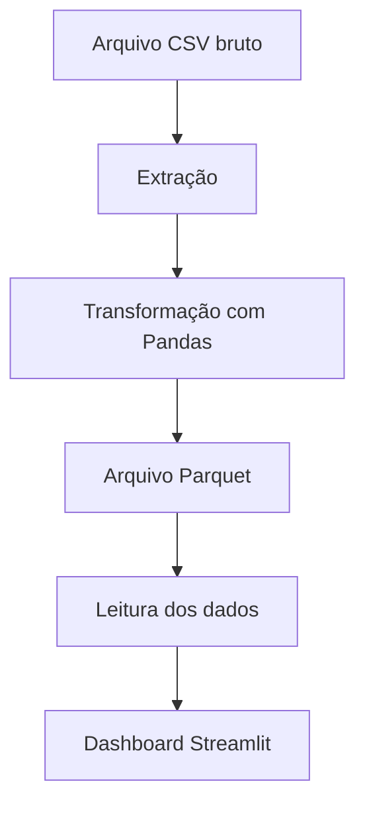

# 🚕 ETL de Dados de Táxis de Nova York

Projeto de Engenharia de Dados desenvolvido para extrair, transformar e preparar dados de corridas de táxis amarelos de Nova York (*NYC Yellow Taxi*), utilizando Python e Pandas. Os dados processados são armazenados em formato Parquet e utilizados em um dashboard interativo desenvolvido com Streamlit.

## 🎯 Objetivo do projeto

O objetivo é construir um pipeline ETL que transforme dados brutos de corridas em informações estruturadas, facilitando a análise de métricas operacionais e padrões de utilização dos táxis.

O projeto também explora a integração entre processamento de dados e visualização, permitindo apresentar os resultados de forma interativa.

## 🔄 Pipeline ETL

O fluxo de processamento é dividido em três etapas:



### 1. Extração

- Leitura do conjunto de dados de corridas de táxis de Nova York.
- Importação dos dados para processamento utilizando Pandas.
- Leitura dos arquivos CSV e preparação para as etapas seguintes.

### 2. Transformação

Os dados são tratados e enriquecidos com informações derivadas para facilitar as análises.

Entre as transformações trabalhadas estão:

- Conversão das colunas de embarque e desembarque para o formato de data e hora.
- Cálculo da duração da viagem em minutos.
- Cálculo da receita por milha percorrida.
- Extração da hora da corrida.
- Extração da data e do dia da semana.
- Cálculo do percentual de gorjeta.
- Agregação de informações por fornecedor e hora, permitindo análises por período.

### 3. Armazenamento

Os dados processados são persistidos em formato **Parquet**, um formato colunar que permite armazenar dados estruturados de forma eficiente e facilita sua leitura posterior para análises.

## 📊 Dashboard interativo

O projeto utiliza Streamlit para apresentar os dados processados em uma interface interativa.

O dashboard permite explorar indicadores e visualizar informações sobre as corridas.

### Indicadores apresentados

- **Quantidade de viagens:** total de corridas consideradas na análise.
- **Distância média:** distância média percorrida nas viagens.
- **Valor médio:** valor médio da métrica monetária selecionada no dashboard.

### Análises disponíveis

- Distribuição das viagens por dia da semana.
- Comparação de métricas agregadas.
- Exploração dos dados processados por meio de gráficos.

## 🛠️ Tecnologias utilizadas

| Tecnologia | Finalidade |
|---|---|
| Python | Desenvolvimento do pipeline |
| Pandas | Manipulação, limpeza e transformação dos dados |
| PyArrow | Suporte à leitura e gravação de arquivos Parquet |
| Parquet | Armazenamento dos dados processados |
| Streamlit | Desenvolvimento do dashboard interativo |
| uv | Gerenciamento de dependências e ambiente Python |
| Git e GitHub | Versionamento e documentação do projeto |

## ⚙️ Pré-requisitos

Para executar o projeto, você precisará de:

- [Python](https://www.python.org/)
- [uv](https://docs.astral.sh/uv/)
- Git

## 🚀 Como executar o projeto

### 1. Clonar o repositório

```bash
git clone https://github.com/joaoassum/etl_yellow_taxi.git
cd etl_yellow_taxi
```

### 2. Instalar as dependências

Com o `uv` instalado, execute:

```bash
uv sync
```

Esse comando instala as dependências declaradas no projeto e prepara o ambiente virtual.

### 3. Disponibilizar os dados

Coloque o arquivo CSV utilizado pelo pipeline no diretório esperado pelo código:

```text
data/yellow_tripdata_2016-03.csv
```

O conjunto de dados corresponde a registros de corridas de táxis amarelos de Nova York. Caso ainda não tenha o arquivo, consulte a fonte oficial de dados da [NYC Taxi & Limousine Commission](https://www.nyc.gov/site/tlc/about/tlc-trip-record-data.page).

### 4. Executar o processamento ETL

Execute o módulo ou comando de entrada configurado no projeto para realizar a extração e a transformação dos dados.

O processo gera o arquivo Parquet utilizado nas análises:

```text
data/yellow_tripdata_2016-03.parquet
```

A forma exata de iniciar o ETL depende do ponto de entrada configurado no `pyproject.toml`.

### 5. Iniciar o dashboard

Na raiz do projeto, execute:

```bash
uv run streamlit run app.py
```

O Streamlit disponibilizará um endereço local no terminal. Normalmente, a aplicação poderá ser acessada em:

[http://localhost:8501](http://localhost:8501)

Certifique-se de que o arquivo Parquet esperado pelo dashboard já tenha sido gerado.

## 💡 Conceitos praticados

Este projeto permite praticar conceitos importantes para Engenharia de Dados:

- Construção de pipelines ETL.
- Leitura e processamento de arquivos CSV.
- Manipulação de datas e horários com Pandas.
- Criação de métricas e atributos derivados.
- Agregação de dados para análise.
- Armazenamento e leitura de arquivos Parquet.
- Separação entre processamento de dados e visualização.
- Desenvolvimento de dashboards com Streamlit.
- Gerenciamento de dependências e versionamento de código.

## 🔮 Melhorias futuras

Algumas evoluções possíveis para o projeto são:

- Implementar testes automatizados para as transformações.
- Adicionar validações de qualidade e tratamento de registros inválidos.
- Automatizar a execução do pipeline.
- Desenvolver novos indicadores e filtros no dashboard.
- Integrar os dados processados a um banco de dados.
- Orquestrar o processamento com Apache Airflow.
- Evoluir o processamento para grandes volumes utilizando PySpark.

## 👨‍💻 Autor

**João Assum**

[GitHub](https://github.com/joaoassum)

---

*Projeto desenvolvido como parte dos estudos em Engenharia de Dados, com foco em ETL, processamento de dados e visualização de informações.*
